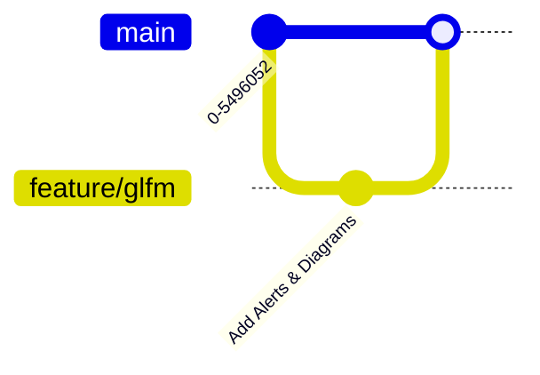

# （仮）GitLab 完全互換Markdownガイド :rocket:

[[_TOC_]]

> [!NOTE]
> **GitLabアラートボックス**: 重要なお知らせや仕様の補足を綺麗にハイライト表示できます。

> [!TIP]
> 効率的な開発のために、直編集機能やMermaid図式法をご活用ください。

## 1. 拡張GLFM機能
- **カラーチップ**: `#fc6d26` (GitLabオレンジ) や `rgb(107,79,187)`
- **差分マーカー**: {+追加された仕様+} と {-削除された記述-}
- **インライン数式**: $`E = mc^2`$

## 2. Mermaid図式法 (9種対応)

